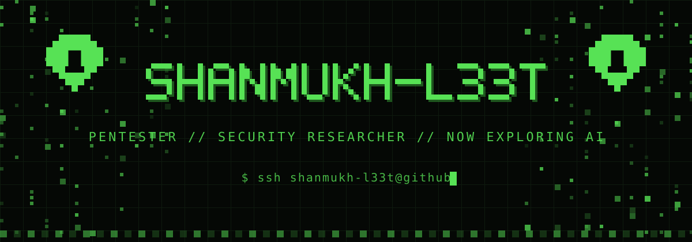

<p align="center">
  
</p>

```text
$ whoami
Shanmukh Dheekonda

$ cat story.txt
[ 5+ yrs ]  breaking web, api & network apps — legally
[ once  ]  hacked NASA. it was legal. ask me.
[ acks  ]  credited for responsibly disclosing critical vulnerabilities
[ now   ]  exploring AI & LLM security
```

<p align="center">
  
</p>

```text
$ ls skills/
```

<p align="center">
  
  
  
  
  
  
  
  <br>
  
  
  
  
</p>

```text
$ ping shanmukh
linkedin → in.linkedin.com/in/shanmukhdheekonda
```

<p align="center">
  <a href="https://in.linkedin.com/in/shanmukhdheekonda"></a>
</p>
